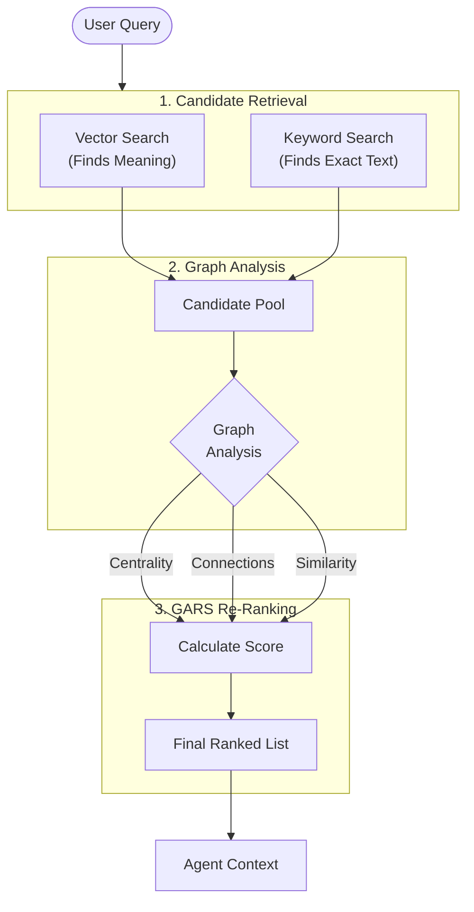

# The Research Engine

Understanding how Vault Intelligence finds, ranks, and synthesizes information from your notes.

## Hybrid Search Architecture

The Researcher uses a three-stage pipeline to ensure it finds relevant information even if you use different terminology than your notes.

## GARS: Graph-Augmented Relevance Score

Most RAG (Retrieval-Augmented Generation) systems only look at similarity (text matching). Vault Intelligence adds two critical dimensions:

1. Similarity: Does the note text match the query?
2. Centrality: Is this note a "hub" or "authority" in your vault structure?
3. Activation: Is this note connected to other relevant notes?

This ensures that a core definition note (eg "Project Alpha MOC") ranks higher than a random daily log mentioning "Project Alpha", even if the daily log has more keyword matches.

## How notes become excerpts

The Researcher reasons over excerpts, so long notes are split into chunks before they can be indexed, with a little overlap so context survives at the seams. Code gets extra care — a chunk cut in the middle of a fenced code block would otherwise start inside a broken snippet — so the splitter knows about fences and applies three rules:

1. Fences that fit the chunk budget are never split, and header-like comment lines inside them (`# comment` in Python, shell, YAML, and similar languages) are not mistaken for Markdown headers.
2. Code too big for the budget is split across many chunks instead of being truncated, cutting between code lines wherever the budget allows. Every interior excerpt is re-balanced with synthetic fence lines matching the block's own marker and language, so each piece still opens and closes its fence, and consecutive excerpts overlap slightly so no context is lost at the cuts. A single line that is itself longer than the budget is the one degenerate case: it must be cut mid-line, but the recorded offsets remain exact.
3. Assembled context stays balanced: the same balancing is applied while the agent builds its working context from full-file injections and clipped snippets, so an open fence in one excerpt can no longer swallow the documents that follow it.

Excerpt boundaries remain exact slices of your note, so anchored matches and highlighting stay correct — equally for notes saved with Windows line endings.

## Spotlight candidate scores

When you prompt the Researcher, it first lists a few "Spotlight candidates" retrieved by hybrid search. The number next to each note is a relative relevance score combining semantic similarity, keyword matching, and their overlap. It is not a percentage: values above 100 are normal for notes that match on several signals at once, and only the ordering of the list matters.

## Visual Grounding

Vault Intelligence provides spatial context for the Researcher's reasoning through the Semantic Galaxy.

1. Analysis: The agent identifies notes that support its answer.
2. Projection: These notes are automatically highlighted in the 3D-like galaxy view.
3. Discovery: You can see not just the cited notes, but also the cluster of related ideas physically surrounding them, helping you verify the agent's logic at a glance.

## Privacy and processing

- Local indexing: Your vault's search index is built and stored on your device — the vectors live in your browser's IndexedDB, and a slim MessagePack copy (vectors and graph edges) is kept in the vault's `.vault-intelligence/` folder.
- Provider reasoning: When you chat, only the relevant snippets of text (found by the local index) are sent to the model provider you connected — Google Gemini, Ollama, or an OpenAI-compatible endpoint.
- No Training: Data sent to the Google API is used strictly for generating the response and is not used to train Google's models.
